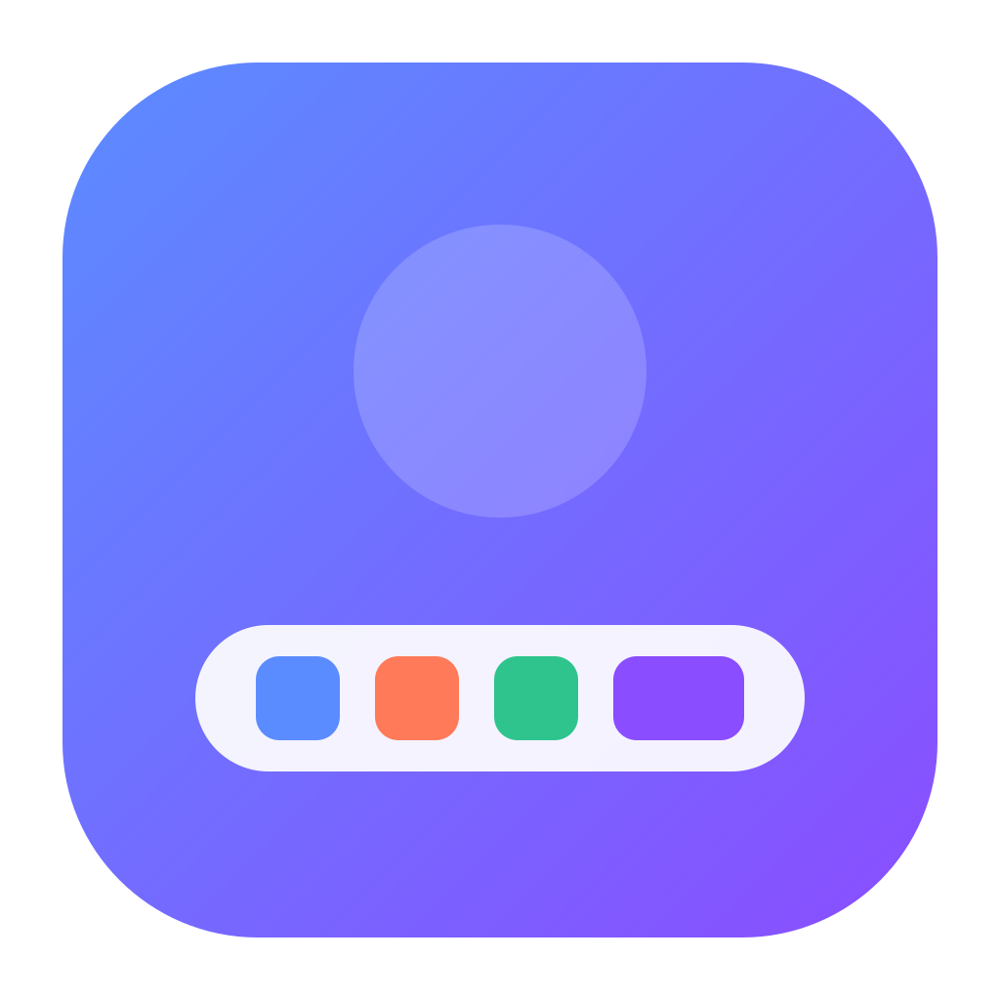

# Pier

  

_Seus apps, widgets e agentes de IA em uma dock personalizável._

O Pier reúne apps fixados e abertos, widgets ao vivo e sessões de agentes de IA em uma única barra no Windows, macOS e Linux. Feito com [Tauri 2](https://tauri.app), Rust e React.

[English](README.md) · **Português**

## Instalação

Baixe o Pier para **Windows**, **macOS** ou **Linux** na [versão mais recente](https://github.com/pier-dock/pier-dock/releases/latest). Veja as versões compatíveis, a configuração inicial e as atualizações no [guia de instalação](docs/guide.pt-BR.md#instalação).

## Documentação

- [Recursos e uso](docs/guide.pt-BR.md)
- [Particularidades de cada plataforma](docs/guide.pt-BR.md#particularidades-de-cada-plataforma)
- [Configuração](docs/guide.pt-BR.md#configuração)
- [Solução de problemas](docs/guide.pt-BR.md#solução-de-problemas)

## Contribuindo

Quer ajudar a desenvolver o Pier? O [guia de contribuição](CONTRIBUTING.pt-BR.md) explica a configuração local, as prévias no navegador, os testes e os pull requests.

## Suporte

Encontrou um bug ou tem uma ideia? [Abra uma issue](https://github.com/pier-dock/pier-dock/issues/new/choose).

## Notas de versão

Veja os downloads e as notas de versão nas [releases do GitHub](https://github.com/pier-dock/pier-dock/releases).

## Licença

Copyright © 2026 Nathan Ferreira e Matheus Basilio. Licenciado sob a [GNU GPL v3.0 ou posterior](LICENSE).
